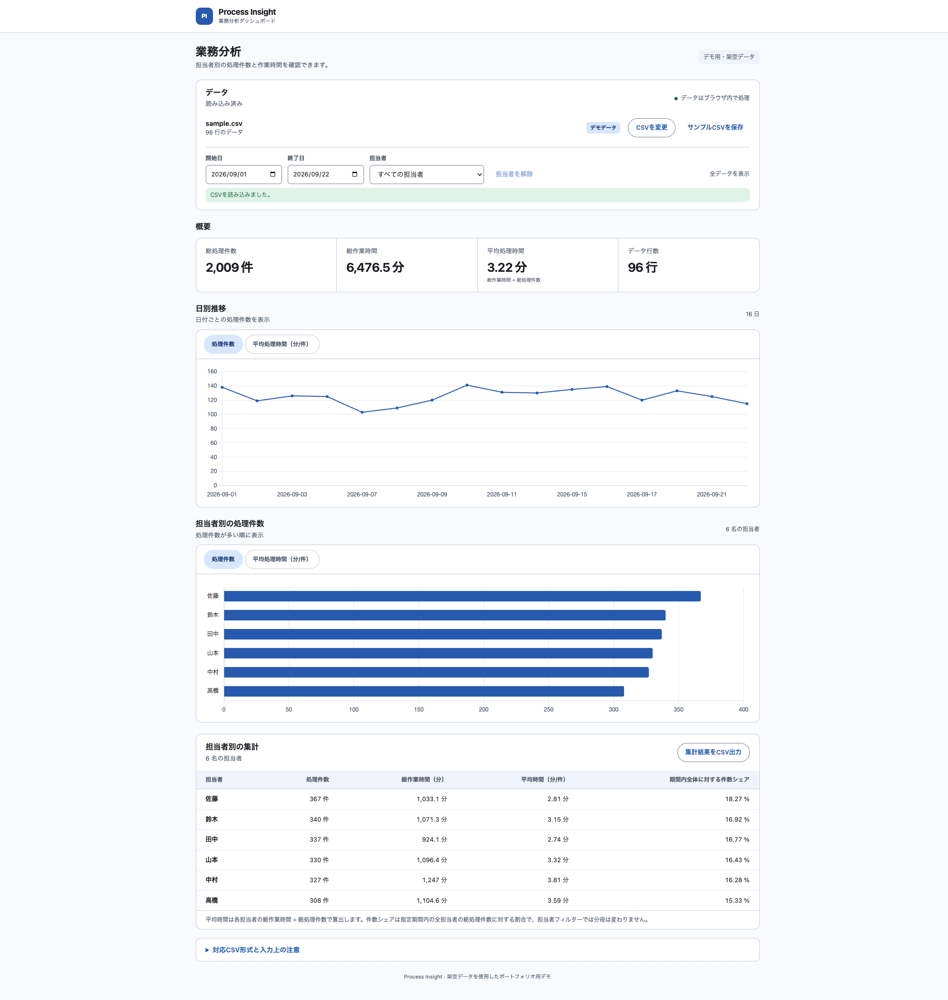
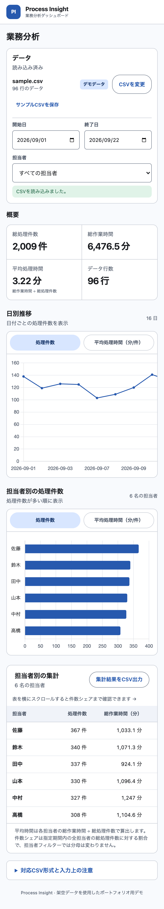

# Process Insight｜CSV業務分析ダッシュボード

**デモ:** [Process Insightを開く](https://engawa-byte.github.io/process-insight/)

CSVから業務の処理量と作業時間を集計し、日別の推移や担当者別の内訳を確認できるWebアプリです。期間・担当者で絞った結果をCSVに出力できます。**架空データを使った自主制作のデモであり、企業への導入・納品実績ではありません。**

## 画面

**PC版**



**スマートフォン版**



## 主な機能

- 初回表示でサンプルCSVを自動読込。手元のUTF-8 CSVはファイル選択またはドラッグ＆ドロップで切替可能
- 総処理件数、総作業時間、平均処理時間、データ行数をKPIで表示
- 日別推移を処理件数／平均処理時間で切替。担当者別グラフも同じ2指標で切替（上位30名）
- 開始日・終了日（両端を含む）と担当者で絞り込み。KPI、グラフ、集計表、CSV出力に連動
- 担当者別集計表に件数シェアを表示し、絞り込んだ集計結果をCSVで保存

## 集計と入力の設計

- **平均処理時間**は総作業時間 ÷ 総処理件数で算出。行ごとの平均を単純平均せず、件数0の場合は算出不可として表示
- **件数シェア**は各担当者の指定期間内の処理件数 ÷ 指定期間内の全担当者の総処理件数。担当者フィルターで分母は変化せず、分母0の場合は「—」
- 必須列、実在日付、0以上の数値などを検証。不正な行があればCSV全体を却下し、直前の分析結果を保持
- CSV出力はUTF-8 BOM付き。数式として解釈され得る文字で始まる値をエスケープ
- CSVの読込・集計はブラウザ内で実行し、アプリからCSVをサーバーへ送信しない

入力CSVの必須列は `日付,担当者,処理件数,作業時間（分）` です。日付は `YYYY-MM-DD`、処理件数は0以上の整数、作業時間は0以上の数値を使用します。最大5MB・20,000データ行まで対応します。

## 使用技術

HTML / CSS / Vanilla JavaScript、Chart.js 4.5.1、Papa Parse 5.7.0。GitHub Pagesで動作する静的サイトです。ライブラリを取得できない場合は、同梱のCSV解析とグラフ代替表示を使用します。

## ローカル実行・テスト

プロジェクトのルートでローカルサーバーを起動し、[http://localhost:8000/](http://localhost:8000/) を開いてください。

```bash
python3 -m http.server 8000
```

Node.jsで集計・入力検証のテストを実行できます。

```bash
node tests/analytics.test.cjs
node tests/daily.test.cjs
node tests/filters.test.cjs
```
